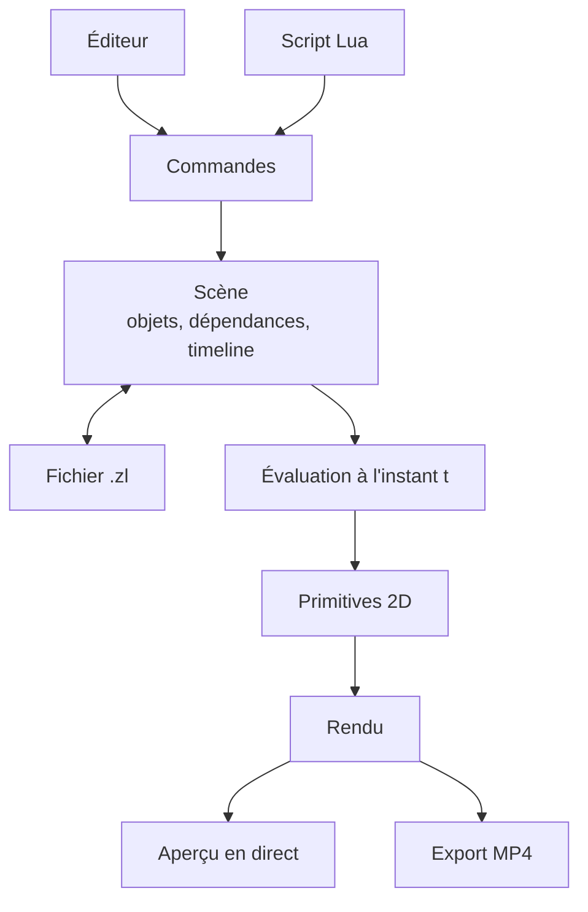

# ZetaAnim

[English](README.md) | **Français**

[](#licence)
[](#feuille-de-route)

**ZetaAnim est un moteur d'animation mathématique open source écrit en Rust, avec un éditeur visuel et un langage de script.**

> [!WARNING]
> ZetaAnim est en développement précoce et n'est pas encore utilisable. Les interfaces et le format des fichiers peuvent changer sans préavis.

## Présentation

ZetaAnim permet de construire des figures mathématiques et de les animer, soit à la souris dans un éditeur avec aperçu en direct, soit en Lua. L'éditeur et le script agissent sur la même scène et peuvent être utilisés ensemble : une partie d'une animation peut être écrite en script puis ajustée dans l'éditeur, et inversement.

Le projet s'adresse aux enseignants, aux étudiants et à toute personne qui explique des mathématiques, sans exiger de compétences en programmation.

## Fonctionnalités prévues

- **Éditeur visuel** : outils de construction (points, segments, cercles, intersections), inspecteur de propriétés, timeline par étapes et aperçu en direct.
- **Géométrie dynamique** : les objets dépendent les uns des autres et la figure se met à jour quand un élément change.
- **Scripts Lua** : tout ce qui est faisable dans l'éditeur l'est aussi en script.
- **Formules mathématiques** : composition avec [Typst](https://typst.app), intégré à l'application.
- **Animations** : tracé progressif, fondus, transformations d'un objet en un autre, écriture de formules, mise en évidence.
- **Export vidéo** au format MP4 et mode présentation étape par étape.
- **3D** (à plus long terme) : courbes, surfaces et sections coniques dans l'espace.

## Architecture

Une scène est une donnée enregistrée dans un fichier `.zl`. Chaque image est calculée par une fonction pure du temps, ce qui permet de se placer à n'importe quel instant de la timeline. L'aperçu et l'export vidéo utilisent le même chemin de rendu.



La racine du dépôt est le paquet `zetaanim`, qui produit l'exécutable de l'application et sert aussi de racine au workspace Cargo. Les bibliothèques sont dans `crates/` et sont ajoutées au fil du développement :

| Crate               | Rôle                                                                                  |
| ------------------- | ------------------------------------------------------------------------------------- |
| `zetaanim` (racine) | Exécutable de l'application, qui lance l'éditeur                                      |
| `zl-math`           | Interpolation, courbes d'animation, courbes de Bézier, géométrie, fonctions spéciales |
| `zl-scene`          | Modèle de scène : objets, paramètres, dépendances, timeline, animations, commandes    |
| `zl-render`         | Rendu 2D avec [tiny-skia](https://github.com/linebender/tiny-skia)                    |
| `zl-tex`            | Composition des formules avec Typst                                                   |
| `zl-export`         | Export vidéo via ffmpeg                                                               |
| `zl-script`         | API de script Lua                                                                     |
| `zl-editor`         | Interface de l'éditeur, construite avec [egui](https://github.com/emilk/egui)         |

## Feuille de route

- [ ] Mise en place du dépôt et de l'intégration continue
- [ ] Moteur sans interface et export MP4
- [ ] Éditeur minimal avec aperçu en direct
- [ ] Formules mathématiques
- [ ] Graphes de fonctions, constructions géométriques et transformations entre objets
- [ ] Scripts Lua et intégration avec l'éditeur
- [ ] Première version publique : exécutables pour macOS et Windows, galerie d'exemples
- [ ] Couche 3D

## Compilation depuis les sources

Prérequis :

- [Rust](https://www.rust-lang.org/tools/install) 1.85 ou plus récent (édition 2024)
- [ffmpeg](https://ffmpeg.org), pour l'export vidéo

```sh
git clone <url-du-dépôt>
cd zetaanim
cargo run --release
```

Aucun exécutable n'est encore fourni à ce stade.

## Contribuer

Les retours, les rapports de bugs et les propositions sont les bienvenus via les issues. Un guide de contribution sera publié avec les premières versions fonctionnelles.

## Utilisation de l'IA

J'écris ZetaAnim moi-même et j'utilise Claude pour relire le code et générer des tests afin de détecter les bugs au plus tôt en couvrant un large éventail de cas et de cas limites (_edge cases_). Je m'en sers également pour échanger sur des idées de conception et d'architecture ; chaque modification du code est écrite par mes soins, et chaque test est relu et commité par moi.

Pour les contributions : relire votre propre code avec une IA ne pose aucun problème, mais merci de ne pas soumettre de code généré par IA. Envoyez uniquement du code que vous avez écrit et que vous comprenez.

## Licence

ZetaAnim est un logiciel libre, distribué sous la licence publique générale GNU (GPL), version 3 ou (à votre choix) toute version ultérieure. Voir [LICENSE](LICENSE) ou <https://www.gnu.org/licenses/gpl-3.0.html>.

Les vidéos et les images que vous créez avec ZetaAnim vous appartiennent : la licence couvre le logiciel, pas ce que vous produisez avec.

Sauf mention contraire explicite, toute contribution soumise pour inclusion dans le projet est distribuée sous cette licence, sans condition supplémentaire.
