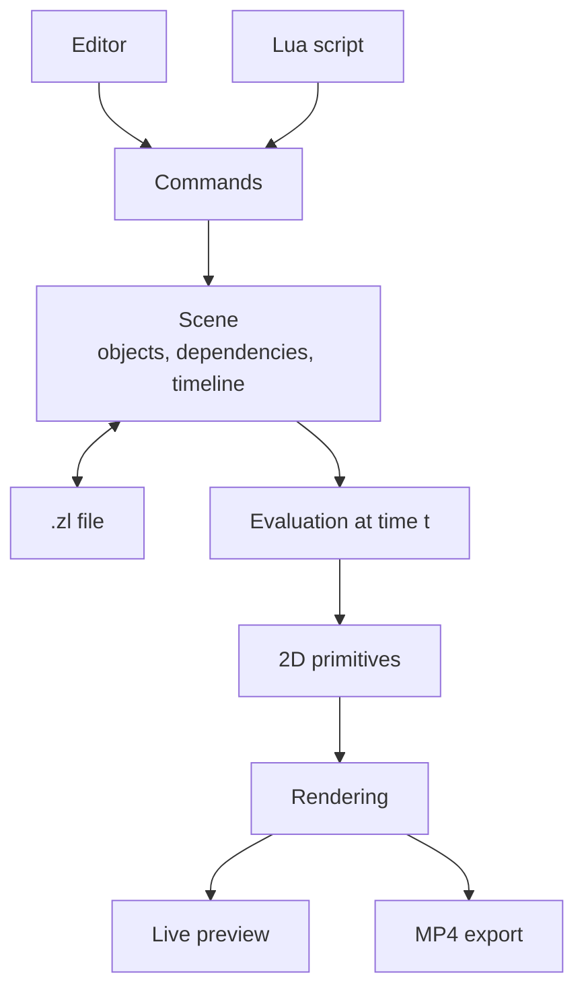

# ZetaAnim

**English** | [Français](README.fr.md)

[](#license)
[](#roadmap)

**ZetaAnim is an open-source mathematical animation engine written in Rust, with a visual editor and a scripting language.**

> [!WARNING]
> ZetaAnim is in early development and not usable yet. APIs and the file format may change without notice.

## Overview

ZetaAnim lets you build mathematical figures and animate them, either with the mouse in an editor with a live preview, or in Lua. The editor and scripts act on the same scene and can be used together: part of an animation can be written as a script and then adjusted in the editor, and vice versa.

The project is aimed at teachers, students and anyone who explains mathematics, without requiring programming skills.

## Planned features

- **Visual editor**: construction tools (points, segments, circles, intersections), property inspector, step-based timeline and live preview.
- **Dynamic geometry**: objects depend on one another, and the figure updates when any element changes.
- **Lua scripting**: anything you can do in the editor can also be done in a script.
- **Mathematical formulas**: typeset with [Typst](https://typst.app), built into the application.
- **Animations**: progressive drawing, fades, transformations from one object into another, formula writing, highlighting.
- **Video export** to MP4 and a step-by-step presentation mode.
- **3D** (longer term): curves, surfaces and conic sections in space.

## Architecture

A scene is data, stored in a `.zl` file. Each frame is computed by a pure function of time, so any point on the timeline can be reached directly. The live preview and video export share the same rendering path.



The repository root is the `zetaanim` package, which builds the application binary and is also the root of the Cargo workspace. The libraries live in `crates/` and are added as development progresses:

| Crate             | Purpose                                                                        |
| ----------------- | ------------------------------------------------------------------------------ |
| `zetaanim` (root) | Application binary, which launches the editor                                  |
| `zl-math`         | Interpolation, easing curves, Bézier curves, geometry, special functions       |
| `zl-scene`        | Scene model: objects, parameters, dependencies, timeline, animations, commands |
| `zl-render`       | 2D rendering with [tiny-skia](https://github.com/linebender/tiny-skia)         |
| `zl-tex`          | Formula typesetting with Typst                                                 |
| `zl-export`       | Video export through ffmpeg                                                    |
| `zl-script`       | Lua scripting API                                                              |
| `zl-editor`       | Editor user interface, built with [egui](https://github.com/emilk/egui)        |

## Roadmap

- [ ] Repository setup and continuous integration
- [ ] Headless engine and MP4 export
- [ ] Minimal editor with live preview
- [ ] Mathematical formulas
- [ ] Function graphs, geometric constructions and transformations between objects
- [ ] Lua scripting and editor integration
- [ ] First public release: macOS and Windows builds, example gallery
- [ ] 3D layer

## Building from source

Requirements:

- [Rust](https://www.rust-lang.org/tools/install) 1.85 or later (2024 edition)
- [ffmpeg](https://ffmpeg.org), for video export

```sh
git clone <repository-url>
cd zetaanim
cargo run --release
```

No prebuilt binaries are available at this stage.

## Contributing

Feedback, bug reports and proposals are welcome through issues. A contribution guide will be published with the first working releases.

## License

ZetaAnim is licensed under either of:

- Apache License, Version 2.0 ([LICENSE-APACHE](LICENSE-APACHE) or <https://www.apache.org/licenses/LICENSE-2.0>)
- MIT License ([LICENSE-MIT](LICENSE-MIT) or <https://opensource.org/licenses/MIT>)

at your option.

Unless you explicitly state otherwise, any contribution intentionally submitted for inclusion in the work by you, as defined in the Apache-2.0 license, shall be dual licensed as above, without any additional terms or conditions.
